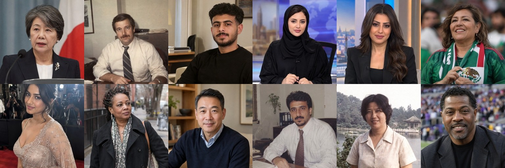
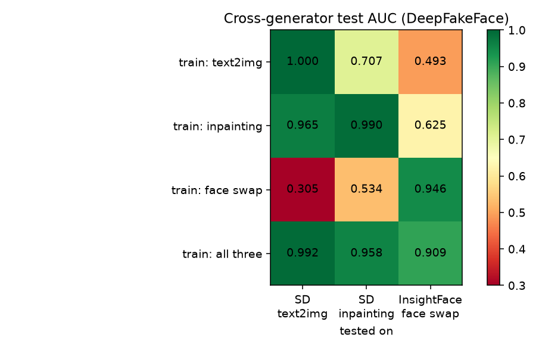
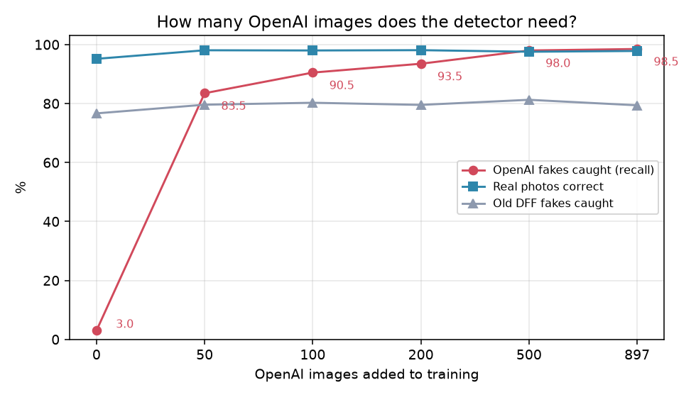

[中文](README.md) | **English** | [한국어](README.ko.md)

# Detecting AI-generated faces: DeepFakeFace replication + OpenAI image detection

A real-vs-AI face detector trained from scratch on one M2 Max Mac, used to answer two questions:

1. **Can a detector recognise generators it has never seen?** (replicating the detector / generator *arms race*)
2. **How many images from a new generator does the detector need to learn it?** (OpenAI's gpt-image family as the test case)

Includes a Gradio web UI: upload a face → probability it is AI-generated + Grad-CAM heatmap.


*Every face above was generated by gpt-image-1.5 / 2 / 2.5. None of these people exist.*

## Contents

- [Key findings](#key-findings)
- [Where the data comes from](#where-the-data-comes-from)
- [Method](#method)
- [Quick start: web UI](#quick-start-web-ui)
- [Full reproduction](#full-reproduction)
- [Limitations](#limitations)
- [License](#license)

## Key findings

| | Result |
|---|---|
| Train on one generator, test on an unseen one | Often drops to chance (AUC 0.3–0.7) |
| Train on all three DFF generators (`all`) | > 0.9 AUC on each, but only 0.44 AUC on OpenAI images |
| Fine-tune with **50** OpenAI images | OpenAI detection rate 3% → **83.5%** |
| Fine-tune with **500** | **98.0%**; more barely helps (897 images: 98.5%) |
| False positives on modern real photos | 0–1.4% (Pexels / PPR10k / FFHQ / Flickr30k / EasyPortrait) |
| AI video (Veo 3, ModelScope, FaceFusion face swap) | **Mostly missed**: no such data in training |

**In one line: a detector only knows the kinds of generator it was trained on, but a few hundred samples from a new generator are enough to catch up.**

### 1. Cross-generator test (DeepFakeFace)



- Trained on SD text-to-image only → face-swap AUC 0.49 (chance).
- Trained on face swap only → text-to-image AUC **0.305**, worse than chance: the model rates diffusion fakes as *more* real than real photos.
- The inpainting-trained model transfers best (0.965 on text-to-image). Inpainting forces it to learn local seams, and those traces generalise better.
- Test set contains only people never seen in training (split by IMDB-WIKI person ID).

### 2. OpenAI learning curve



Tested on the same 200 held-out OpenAI images + 3,000 real photos from 6 sources:

| OpenAI images added | OpenAI AUC | OpenAI detected | Real correct | Old DFF fakes detected |
|---|---|---|---|---|
| 0 | 0.412 | 3.0% | 95.2% | 76.7% |
| 50 | 0.976 | 83.5% | 98.1% | 79.6% |
| 100 | 0.991 | 90.5% | 98.0% | 80.3% |
| 200 | 0.994 | 93.5% | 98.1% | 79.5% |
| 500 | 0.998 | 98.0% | 97.6% | 81.3% |
| 897 | 0.999 | 98.5% | 97.8% | 79.4% |

gpt-image-1.5, 2 and 2.5 are each detected at about 98%. Among real photos, only the old DFF wiki photos have a high false-positive rate (about 10%; they are small and blurry). Full numbers in [`results/`](results/).

### 3. Video

2 frames per second → YuNet face detection → score each face. The best model's median score is below 0.3 for Veo 3, ModelScope, an AI fake-news video, and a FaceFusion 3.9 face-swap video, i.e. mostly missed. Reasons: no video-generator or new face-swap training data, and H.264 compression wipes out fine traces.

## Where the data comes from

Three kinds of data, about 150k images in total. Everything is converted to 256×256 JPEG (quality 95).

### A. DeepFakeFace (DFF): main training set

- Source: [OpenRL/DeepFakeFace](https://huggingface.co/datasets/OpenRL/DeepFakeFace) (Hugging Face, OpenRAIL licence, 4 zips, about 5 GB)
- Contents:

| zip | Class | Count | How made |
|---|---|---|---|
| `wiki.zip` | real | 30,000 | IMDB-WIKI celebrity photos |
| `text2img.zip` | fake | 30,000 | Stable Diffusion v1.5 text-to-image |
| `inpainting.zip` | fake | 30,000 | SD Inpainting (partial repaint of real photos) |
| `insight.zip` | fake | 30,000 | InsightFace face swap |

- All four zips share one layout: `<class>/<00–99>/<personID>_<birthdate>_<photoyear>.jpg`. Each fake has the same filename as the real photo it came from.
- The subfolder number is the last two digits of the person ID, so one person is always in one folder. Splitting by folder therefore cannot leak people between splits: **00–79 train, 80–89 val, 90–99 test**.
- Real photos come in mixed sizes. The DFF authors stretched them to 512×512 before generating fakes, so this project stretches everything to 256×256 and real and fake share the same geometry.
- Full list: [`data_lists/dff_manifest.csv`](data_lists/dff_manifest.csv).

### B. OpenAI-generated faces: made by this project

- Generated with the OpenAI Images API (`/v1/images/generations`, 1024×1024, default medium quality).
- 3 models: gpt-image-2 (434 images), gpt-image-1.5 (332), gpt-image-2.5 (331), **1,097 in total** (1,100 requested; the API rejected 3 with HTTP 400).
- Prompts are random combinations (fixed seed 0, fully reproducible):

```
Realistic photograph of a {age} {ethnicity} {gender} {scene}, face clearly visible, upper body, {photo style}. No text, no watermark.
```

  - 6 ages (young … elderly) × 6 ethnicities × 2 genders × 8 scenes (red carpet, press conference, street, office, sports event, TV studio, …) × 5 styles (2008 digital camera, news-agency photo, amateur phone photo, professional headshot, old scanned photo).
  - Scenes and styles deliberately imitate IMDB-WIKI celebrity news photos, so real and fake have similar subjects.
- Originals are PNG (about 1024–1300 px) and carry OpenAI's embedded C2PA content credentials. For training they are centre-cropped to a square and resized to 256×256.
- Download: [Releases v0.1](../../releases/tag/v0.1)

| File | Contents |
|---|---|
| `openai_faces_256.zip` (26 MB) | 1,097 × 256×256 JPEG (the version used for training) |
| `openai_faces_orig_part1.zip` / `part2.zip` (1.1 GB each) | Original PNGs |
| `openai_meta.json` | Model and prompt for each image |

### C. Modern real portraits: blocking the "sharp = fake" shortcut

DFF's real photos are mostly old and blurry, while OpenAI images are sharp and modern. With only DFF real photos, a model could learn "sharp modern photo means fake". So five more real-photo sets were added:

| Source | Contents | Used | How sampled |
|---|---|---|---|
| [FFHQ](https://huggingface.co/datasets/bitmind/ffhq-256) | High-res Flickr faces (aligned crops) | 4,375 | First parquet shard of `bitmind/ffhq-256` |
| [Pexels Portrait](https://huggingface.co/datasets/gaunernst/pexels-portrait) | Professional portrait photography | 3,000 | Only Pexels IDs < 14,000,000 (uploaded before ~2023, avoiding AI images), random sample |
| [PPR10k](https://huggingface.co/datasets/JarvisArt/MMArt-PPR10k) | Unretouched portrait-shoot photos | 3,000 | Each sample's `before.jpg`, random sample |
| [Flickr30k](https://huggingface.co/datasets/nlphuji/flickr30k) | Everyday photos | 1,458 | 3,000 random files from the zip; about half were macOS `._` metadata files and were skipped |
| [EasyPortrait](https://huggingface.co/datasets/gofixyourself/EasyPortrait) | Webcam selfies (video-call setting) | 3,000 | Random sample from `data/test.zip` |

- All sampling uses fixed seed 0. Non-square images are centre-cropped; portrait-orientation images are cropped from the top to keep the face.
- These photos show identifiable real people, and some licences forbid redistribution, so **this repo does not include them**. The ID of every image used is listed in [`data_lists/`](data_lists/).

## Method

| Step | File | Details |
|---|---|---|
| Data | `prepare.py` | Download DFF → 256×256 → split by person folder, write `data/manifest.csv` |
| Training | `train.py` | EfficientNet-B0 (timm, ImageNet-pretrained) binary classifier. AdamW + OneCycle, lr 3e-4, batch 64, 4 epochs, keep the epoch with best val AUC. Both classes get identical random downscaling / blur / JPEG / crop / flip / colour jitter, so sharpness can't be used as a shortcut. Each epoch uses all real images + an equal random sample of fakes (balanced classes) |
| Experiments | `run_all.sh` | 4 models: `t2i`, `inpaint`, `insight`, `all` |
| OpenAI fakes | `gen_openai.py` | See B above |
| Modern reals | `fetch_real.py` | See C above |
| Zero-shot test | `eval_openai.py` | DFF models tested directly on OpenAI images |
| Learning curve | `openai_curve.py` | 200 of the 1,097 OpenAI images are held out for testing; the other 897 form the training pool. Starting from `all`, fine-tune for 3 epochs (lr 1e-4) with N images (0/50/100/200/500/897). Each epoch: about 6,000 real images (up to 1,000 from each of 6 sources) + 3,000 DFF fakes + 3,000 OpenAI images (the N images resampled). Test reals = 500 from each of the 6 sources, disjoint from training |
| Video | `video_scan.py` | 2 fps, YuNet face detection, DFF-style crop (face ≈ 45% of width), score, contact sheet |
| Web UI | `app.py` | Gradio: upload → probability + Grad-CAM; switch models; cross-generator results table |

## Quick start: web UI

Needs [uv](https://docs.astral.sh/uv/). Uses MPS on Apple Silicon, CUDA on NVIDIA, otherwise CPU.

```bash
git clone https://github.com/coobabm/dff-detector.git
cd dff-detector
uv sync
# Download model weights and unzip in the repo root (gives runs/*/model.pt)
curl -LO https://github.com/coobabm/dff-detector/releases/download/v0.1/models.zip
unzip models.zip
uv run app.py      # open http://127.0.0.1:7860 and pick all_openai
```

`models.zip` contains 5 models:

| Folder | Training data | Use |
|---|---|---|
| `runs/all_openai/` | All 3 DFF types + 897 OpenAI + 6 real sources | **Recommended**, best overall |
| `runs/all/` | All 3 DFF types | Baseline |
| `runs/t2i/` `runs/inpaint/` `runs/insight/` | One DFF type each | Arms-race experiment |

## Full reproduction

Run in order. Times measured on an M2 Max (64 GB); needs about 20 GB of disk.

```bash
# 0. Environment
uv sync

# 1. DFF: download 4 zips (5 GB) → resize → split (~10 min + download)
uv run prepare.py

# 2. The 4 DFF models (~3 h)
./run_all.sh
#    results: runs/<name>/results.json, logs: logs/

# 3. OpenAI images
#    Option a: use the released images (recommended, identical results)
curl -LO https://github.com/coobabm/dff-detector/releases/download/v0.1/openai_faces_256.zip
mkdir -p data/img256 data/openai
unzip openai_faces_256.zip -d data/img256 && mv data/img256/meta.json data/openai/
#    Option b: generate your own (~2 h, needs an API key; OpenAI output is random, so images will differ)
export OPENAI_API_KEY=sk-...
#    export OPENAI_BASE_URL=...   # set this if using an OpenAI-compatible proxy
uv run gen_openai.py --n 100 --models gpt-image-2            # images 0–99
uv run gen_openai.py --n 1100 --start 100 \
    --models gpt-image-1.5 gpt-image-2 gpt-image-2.5          # images 100–1099, rotating 3 models

# 4. Modern real photos (~30 min, ~10 GB download; archives are deleted after processing)
uv run fetch_real.py ffhq pexels ppr10k flickr30k easyportrait

# 5. Zero-shot test of DFF models on OpenAI images (a few minutes)
uv run eval_openai.py

# 6. Learning curve (~40 min) → runs_openai/curve.json, runs_openai/n*.pt
uv run openai_curve.py

# 7. Put the final model into the web UI
mkdir -p runs/all_openai && cp runs_openai/n897.pt runs/all_openai/model.pt
uv run app.py

# 8. (Optional) scan a video
uv run video_scan.py your_video.mp4   # → scans/<video>.jpg / .json
```

Notes:

- All random seeds are fixed at 0, but GPU training is not fully deterministic, so reproduced numbers will vary slightly (usually ±1%).
- Pexels images come from the Pexels CDN; a few may have been removed by their authors and are skipped.
- `gen_openai.py` skips images that already exist, so you can rerun it after an interruption to continue.

## Limitations

- OpenAI test and training images come from the same prompt template. Selfies, group photos, and images re-compressed by messaging apps will likely score lower.
- Faces only, and only SD 1.5, InsightFace and the gpt-image family. Midjourney, Flux, Gemini etc. are untested.
- Single-frame model; it does not use temporal information in video.
- When a new generator appears, the detector needs new samples and fine-tuning again. That is the arms race.

## License

- Code: MIT (see [LICENSE](LICENSE)).
- OpenAI-generated images (`openai_faces_*` in the release and `docs/openai_samples.jpg`): generated by this project with the OpenAI API and shared under CC BY 4.0; please give credit. None of the people shown exist.
- Third-party datasets: **not redistributed** here, only file lists. Their own licences apply: DFF (OpenRAIL), FFHQ (CC BY-NC-SA 4.0), EasyPortrait (CC BY-SA 4.0), Pexels (Pexels License), Flickr30k / PPR10k (research use only).

For research and teaching only. Detection results are not evidence of authenticity.
