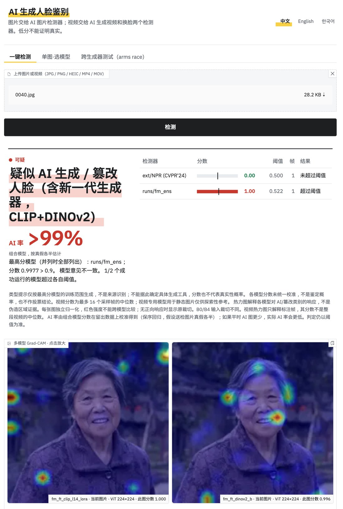
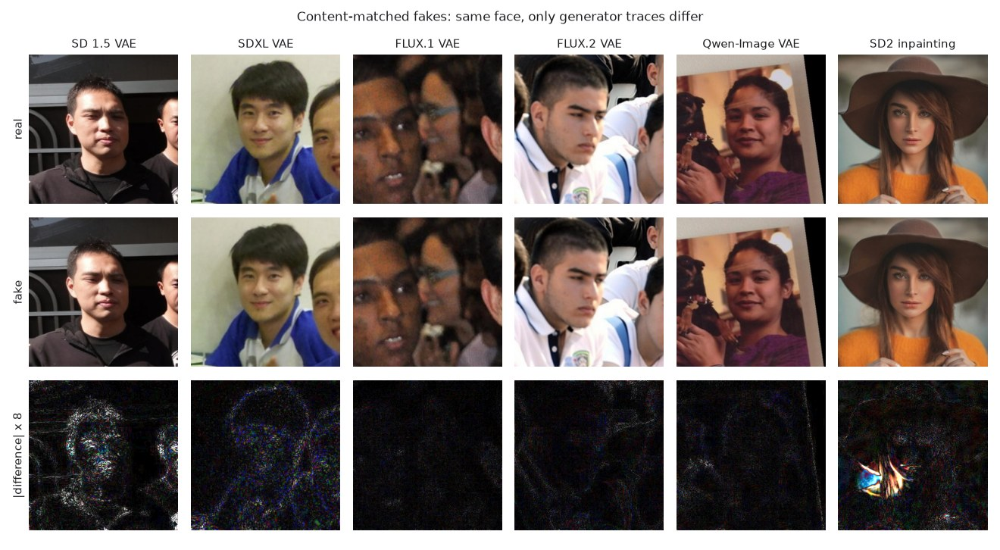
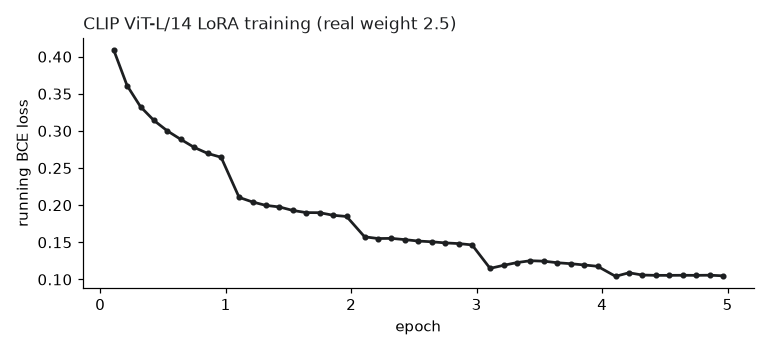
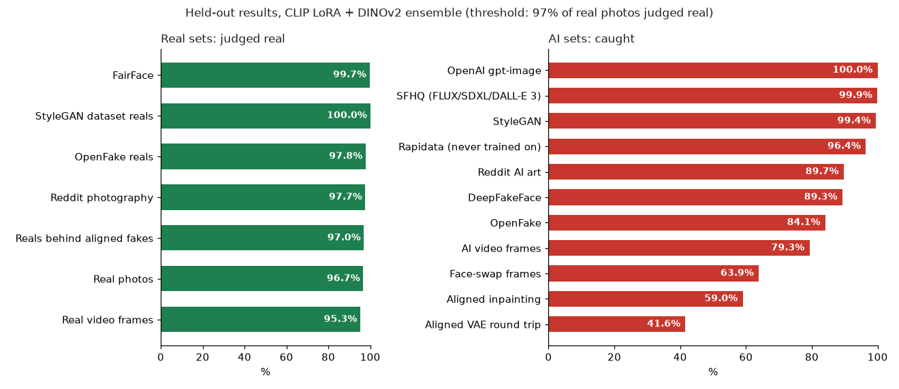
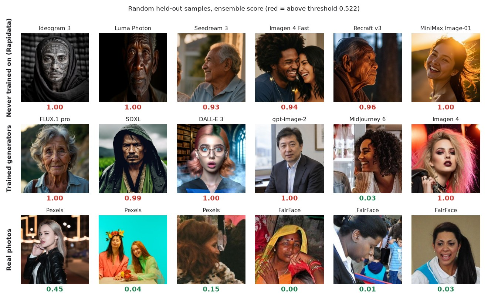
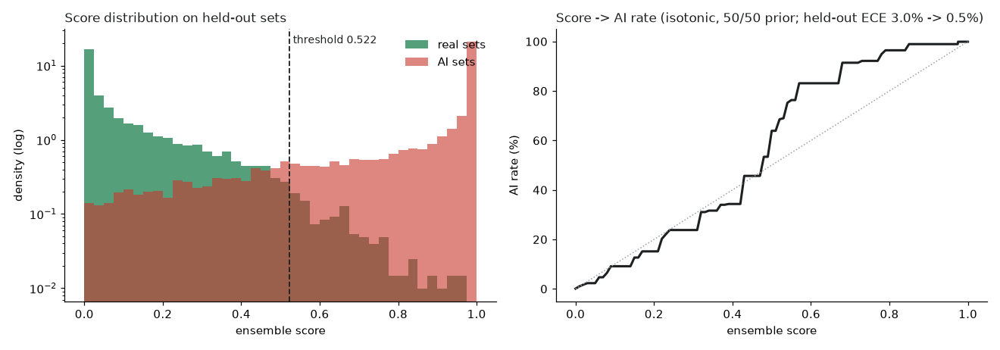

**中文** | [English](README.en.md) | [한국어](README.ko.md)

# AI 生成人脸鉴别：CLIP + DINOv2 组合模型

判断一张人脸图是真人照片，还是 AI 生成 / 篡改的。本文只介绍最新一轮训练：做了什么、用了哪些数据、在留出测试集上的结果。

附带 Gradio Web UI（中文 / English / 한국어）：上传图片，给出判定、校准后的“AI 率”和 Grad-CAM 热力图；上传视频，交给单独的视频检测器。



*Web UI：上传一张 OpenAI 生成的人脸（本项目生成），组合模型判为 AI，AI 率 >99%，下方是两个成员模型的 Grad-CAM。*

## 最终模型

两个模型的 P(fake) 取平均，阈值 **0.522**：

| 成员 | 骨干 | 训练方式 |
|---|---|---|
| `fm_ft_clip_l14_lora` | CLIP ViT-L/14（OpenAI） | **全层 LoRA**（本轮新训） |
| `fm_ft_dinov2_b` | DINOv2-B（带 registers） | 解冻最后 4 层（上一轮，保留） |

阈值的定法：留出真照片的一半上取 97 分位，即真照片约 97% 判为真；下文的数字都在另一半和其他测试集上算。

## 本轮训练做了什么

1. **LoRA 全层微调**：CLIP ViT-L/14 每一层的 `qkv`、`proj`、`fc1`、`fc2` 都加 LoRA（r=16，alpha=32，dropout 0.05），分类头和最后的 LayerNorm 全量训练；原权重冻结，可训练参数 6.3M。LoRA 学习率 2e-4，分类头 1e-3，AdamW，200 步预热 + 余弦衰减，5 轮。训练完把 LoRA 合并回原权重，存成普通 timm 模型，推理时不需要 peft。
2. **损失里加大真图权重**：`BCEWithLogitsLoss(pos_weight=0.4)`，相当于真图权重是假图的 2.5 倍。把真脸判成 AI 代价更大，模型分数整体往下压：上一版的阈值是 0.715，这一版是 0.522，接近 0.5。
3. **扩大同内容假图**（B-Free 的做法）：把真人脸经过生成模型的自编码器往返一次，或局部重绘一块，内容和原图完全相同，模型只能去学生成痕迹，没法靠“是谁、在哪拍的”走捷径。本轮新增 FLUX.2、Qwen-Image 两种 VAE，SD1.5 / SDXL / FLUX VAE 补量，SD2 局部重绘增加到 1,190 张。
4. **补新生成器数据**：OpenFake 再加 9 个分片，多了约 1.2 万张人脸（gpt-image、nano-banana、Imagen 4、Midjourney、Seedream 等，以及配套的 LAION / Pexels 真图）。
5. **相机直出真图**：从作者自己的相册里挑了未经编辑、EXIF 里没有修图软件、有相机型号的带脸照片，作为真图训练（只在本地使用，不公开）。
6. **测试时增强**：试了水平翻转取平均，对这一对模型没有提升，没有启用（`ensemble.json` 里加 `"tta": true` 可以打开）。


*同内容假图：上排真图，中排假图，下排是两者差异放大 8 倍。VAE 往返只留下很淡的痕迹，局部重绘只改一块区域。*

每轮从每类数据里均衡抽样 15,000 张真图 + 15,000 张假图（类内每个来源份额相同），统一裁成 256 px 宽松人脸、JPEG q95。训练增强：随机缩放模糊、高斯模糊、JPEG 50–95、电影感调色、随机裁剪、水平翻转、轻微颜色抖动，真假两类做同样的增强。

### 训练数据

| 真图 | 张数 | 假图 | 张数 |
|---|---|---|---|
| FairFace（各年龄 / 肤色） | 25,940 | SFHQ-T2I（FLUX、SDXL、DALL-E 3） | 10,961 |
| 真视频截图 | 8,155 | 换脸视频截图（FaceFusion 等） | 7,430 |
| 真照片（FFHQ / Pexels / PPR10k / Flickr30k / EasyPortrait / DFF 真图） | 5,958 | OpenFake（gpt-image、nano-banana、Imagen、MJ、Seedream…） | 7,064 |
| OpenFake 真图（LAION / Pexels） | 5,656 | AI 视频截图（Veo / Sora / Kling / 数字人…） | 6,804 |
| StyleGAN 数据集里的真图 | 4,660 | 同内容 VAE 往返（SD1.5 / SDXL / FLUX / FLUX.2 / Qwen-Image） | 6,458 |
| Reddit 摄影版 + 相机直出照片 | 2,138 | DeepFakeFace（SD 文生图 / 局部重绘 / InsightFace 换脸） | 6,000 |
| 同内容假图对应的真图 | 1,190 | Reddit AI 绘图版 | 5,957 |
| | | StyleGAN2/3 | 3,648 |
| | | 同内容 SD2 局部重绘 | 1,190 |
| | | OpenAI gpt-image | 897 |



## 结果



留出测试集（训练时没见过的人物 / 帖子 / 视频；Rapidata 一张都没训练过）：

| 真人：判对率 | | AI：检出率 | |
|---|---|---|---|
| 真照片 | 96.7% | OpenAI gpt-image | 100% |
| 真视频截图 | 95.3% | SFHQ（FLUX / SDXL / DALL-E 3） | 99.9% |
| FairFace | 99.7% | StyleGAN | 99.4% |
| OpenFake 真图 | 97.8% | DFF SD 文生图 / 局部重绘 / 换脸 | 97.2% / 94.6% / 76.2% |
| Reddit 摄影版 | 97.7% | **Rapidata（最新生成器，没训练过）** | **96.4%** |
| StyleGAN 数据集真图 | 100% | Reddit AI 绘图 | 89.7% |
| 同内容假图对应的真图 | 97.0% | OpenFake | 84.1% |
| | | AI 视频截图 | 79.3% |
| | | 换脸视频截图 | 63.9% |
| | | 同内容局部重绘 | 59.0% |
| | | 同内容 VAE 往返 | 41.6% |


*从留出测试集随机抽取（不是挑出来的），数字是组合分数，红色 = 超过阈值。第一行的生成器训练时一张都没见过；第二行的 Midjourney 6 这张漏检了。*

- 真人集平均判对 97.7%，假图平均检出 82.1%。
- 单独看 CLIP LoRA 模型，假图平均检出 88.0%，但真人集平均判对只有 96.9%（真视频截图 93.4%）。和 DINOv2 平均后，真图误报回到原来的水平。
- 同内容 VAE 假图最难：和原图内容一模一样，只差自编码器留下的细微痕迹。

**AI 率**：组合分数用保序回归在留出数据上校准（假设送检图片真假各半，每个测试集等权），留出一半上的校准误差 ECE 3.0% → 0.5%。分数 0.3 ≈ AI 率 24%，0.5 ≈ 64%，0.9 ≈ 99%。判定仍然按阈值。


*左：真图和 AI 图在留出集上的分数分布（对数纵轴）；右：分数到 AI 率的校准曲线。*

完整数字：`results/fm_combo.json`（组合挑选）、`results/arms_race.json`（全部模型 × 全部测试集）。

## 使用

需要 [uv](https://docs.astral.sh/uv/)。Apple Silicon 用 MPS，NVIDIA 用 CUDA，否则用 CPU。

```bash
git clone https://github.com/coobabm/dff-detector.git
cd dff-detector
uv sync
uv run app.py      # http://127.0.0.1:7860
```

Web UI 从 `runs/fm_ens/ensemble.json` 读组合成员，权重放在 `runs/<成员名>/model.pt`。本轮权重没有放进 Release，需要按下面的步骤自己训练。

## 复现本轮训练

前几轮的数据（DFF、OpenAI 生成图、现代真图、StyleGAN、视频截图）用 `prepare.py`、`gen_openai.py`、`fetch_real.py`、`fetch_gan.py`、`extract_tight.py` 准备，见本仓库的提交历史。本轮新增：

```bash
# 新生成器 / 真图（Hugging Face）
uv run fetch_hf.py sfhq
uv run fetch_hf.py openfake
uv run fetch_hf.py openfake lists/openfake_shards2.txt openfake2   # 本轮新增的 9 个分片
uv run fetch_hf.py fairface
uv run fetch_hf.py rapidata                                        # 只做测试
uv run fetch_hf.py manifest

# Reddit（需要 rdt-cli 并 rdt login）
uv run fetch_reddit.py list && uv run fetch_reddit.py list_real
uv run fetch_reddit.py download && uv run fetch_reddit.py faces

# 同内容假图：第 1 轮，再加第 2 轮（新 VAE + 更多局部重绘）
uv run gen_aligned.py
uv run gen_aligned.py --round 2 --train 6000 --test 1000 --max-inpaint 1200 --only vae_flux2 vae_qwen vae_sd15 vae_sdxl vae_flux
uv run gen_aligned.py --round 2 --train 6000 --test 1000 --max-inpaint 1200 --only inpaint

# 可选：自己相册里的相机直出人脸（macOS Photos）
uvx osxphotos query --json --not-edited --only-photos > /tmp/myphotos_query.json
uv run fetch_myphotos.py /tmp/myphotos_query.json

# 训练
FM_LORA=16 FM_REAL_WEIGHT=2.5 FM_TAG=_lora uv run fm_detector.py finetune clip_l14 5
uv run fm_detector.py finetune dinov2_b 4   # 线上用的是上一轮训练的版本，用现在的数据重训数字会略有不同

# 评估、挑组合、校准
uv run fm_compare.py fm_ft_clip_l14_lora fm_ft_dinov2_b
uv run calibrate.py
uv run arms_race.py
uv run make_figures.py   # 本页配图
```

## 局限

- 只看人脸区域，不判断背景和整张图。
- 换脸截图（64%）和同内容 VAE 假图（42%）仍然弱。视频换脸主要靠单独的视频检测器。
- 截图、多次转发压缩的图分数会偏低。
- 新生成器出现后，还需要补数据再训练。

## 许可

- 代码：MIT（见 [LICENSE](LICENSE)）。
- 第三方数据集只在本地使用，本仓库**不分发**：FairFace（CC BY 4.0）、SFHQ-T2I（MIT）、OpenFake（CC BY-NC 4.0）、Rapidata（CDLA-Permissive-2.0）、DFF（OpenRAIL）、FFHQ（CC BY-NC-SA 4.0）、Reddit 帖子（遵循 Reddit 条款）等。
- `docs/round_*` 配图里的样例图来自 Rapidata（CDLA-Permissive-2.0）、SFHQ-T2I（MIT）、OpenFake（CC BY-NC 4.0）、FairFace（CC BY 4.0）、Pexels（Pexels License）和本项目自己生成的 OpenAI 图，仅作说明用途。
- 对比用的公开检测器（UnivFD、NPR、B-Free）不在仓库里，请从各自项目获取并遵循其许可。

本项目仅供研究与教学，检测结果不能作为鉴定依据。
